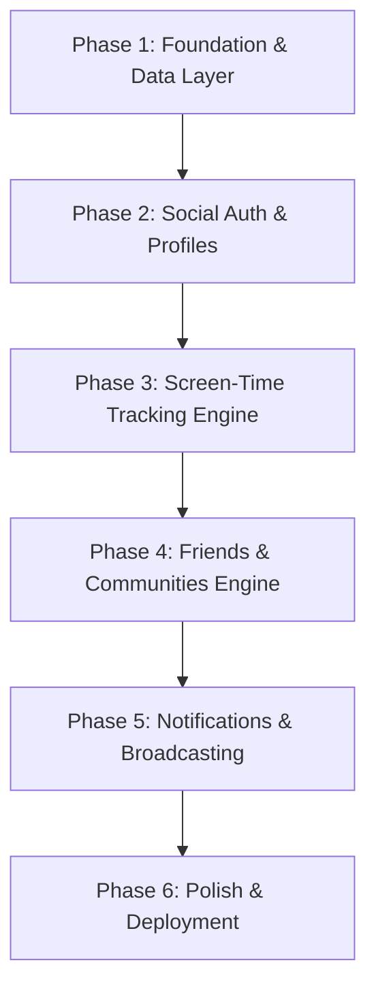

# BrainRotWatch Development Roadmap

A comprehensive, multi-step engineering plan for building **BrainRotWatch**—a mobile-first social screen-time tracking app with 1-on-1 friend connections, invite-only community leaderboards, social authentication, and real-time alerts.

---

## Technical Overview & Stack Selection

* **Frontend:** Native Android (Kotlin, Jetpack Compose Material 3, Coroutines, StateFlow).
* **Backend Platform ($0 Free Tier):** Supabase / Firebase
  * **Authentication:** Device / OAuth (Google, Apple).
  * **Database:** PostgreSQL (Supabase) or Firestore (Firebase) for relational community, friend & user state.
  * **Notifications:** Firebase Cloud Messaging (FCM) for background alerts.
  * **Deep Linking:** Android App Links for friend codes & community invite links.
* **On-Device Tracking:** Android `UsageStatsManager` & `WorkManager`.

---

## Multi-Step Development Plan

---

### Phase 1: Foundation & Data Layer Setup
> **Goal:** Establish the project architecture, backend environment, and core domain models.

* **Step 1.1: Backend Project Setup**
  * Provision a free Supabase project.
  * Configure PostgreSQL schema (`users`, `user_friends`, `communities`, `community_members`, `community_requests`, `daily_usage`).
* **Step 1.2: App Architecture Alignment**
  * Structure the Android app into clean layers: `data` (repositories, data sources), `domain` (models, use cases), and `ui` (Compose screens, ViewModels).
  * Integrate dependency injection or state container management.

---

### Phase 2: Social Authentication & User Profiles
> **Goal:** Enable friction-free social sign-in and photo syncing.

* **Step 2.1: Social OAuth Integration**
  * Integrate Credential Manager / Firebase Auth for Google and Apple login.
  * Configure OAuth credentials in Google Cloud Console.
* **Step 2.2: User Profile Sync**
  * Auto-populate display name, avatar photo URL, and generate unique `friend_code` upon first sign-in.
  * Store user initial settings (screen-time goals, notification toggles).

---

### Phase 3: Core Screen-Time Tracking Engine
> **Goal:** Accurately measure on-device app usage for target "brain-rot" applications.

* **Step 3.1: Usage Stats Permission Flow**
  * Build the `UsageStatsManager` permission check and onboarding screen (`UsageAccessLockScreen`).
* **Step 3.2: Usage Reader & Repository**
  * Implement `DeviceUsageRepository` to fetch daily usage minutes for selected target apps (TikTok, Instagram, YouTube, etc.).
* **Step 3.3: Background Syncing Worker**
  * Create a `WorkManager` periodic job to sync daily screen-time totals to the backend in the background.

---

### Phase 4: Direct Friends & Communities Engine
> **Goal:** Build 1-on-1 friend connections, invite links, community leaderboards, and democratic admission voting.

* **Step 4.1: Direct Friend Connections (1-on-1)**
  * Add friends via unique `friend_code` or direct share link.
  * Manage friend requests (`PENDING`, `ACCEPTED`, `BLOCKED`) and view direct friend screen-time rankings.
* **Step 4.2: Deep Linking & Community Invite Handler**
  * Implement Android App Links to handle invite URLs (e.g., `brainrotwatch.app/join?code=XYZ`).
* **Step 4.3: Community Management UI & Logic**
  * **Open Communities:** Instant join via invite code.
  * **Closed Communities:** Send request $\rightarrow$ Admin receives approval notification.
  * **Democratic Communities:** Send request $\rightarrow$ Existing members receive voting prompt $\rightarrow$ Auto-admit when majority threshold is met.
* **Step 4.4: Real-Time Sorted Leaderboards & Stale Sync Badges**
  * Build sorted leaderboards for both direct friends and community members.
  * Display a **"Last Synced"** timestamp or warning badge (e.g. ⚠️ *Last synced 3h ago*) if a user's background sync is stale (> 45 min inactive during waking hours).

---

### Phase 5: Notifications & Real-Time Broadcasting
> **Goal:** Keep users engaged with limit warnings, daily summaries, voting alerts, and stale sync reminders.

* **Step 5.1: FCM Integration**
  * Set up Firebase Cloud Messaging for push notifications.
* **Step 5.2: Notification Triggers**
  * **Limit Threshold Alerts:** Notify friends & community members when a user exceeds their daily screen-time goal.
  * **Stale Sync Reminders:** Server-side cron job (Supabase `pg_cron` / Edge Function) sends a push alert to users whose background sync appears paused or force-stopped during daytime.
  * **Daily Summary:** Trigger end-of-day broadcasts highlighting top/bottom screen-time users.
  * **Friend & Admission Requests:** Alert users when receiving a friend request or community join request.

---

### Phase 6: Polish, Testing & Deployment
> **Goal:** Ensure high performance, accessibility, and smooth user experience.

* **Step 6.1: UI/UX Refinement**
  * Apply Material 3 styling, smooth Compose animations, edge-to-edge support, and dark mode support.
* **Step 6.2: Automated & Manual Testing**
  * Write unit tests for voting calculation logic, friendship queries, and usage parsing.
  * Verify edge cases (offline usage logging, deep link fallback).
* **Step 6.3: Google Play Store Release**
  * Prepare store listing, privacy policy (detailing `UsageStats` disclosure), and publish build.
